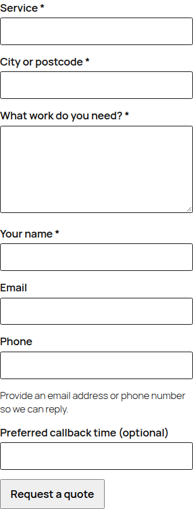

# Digicyfr Service Quote Desk PL

A free WordPress plugin for Polish service firms that price work individually. A customer sends a short quote request from a phone; staff track contact, quote and outcome in a private WordPress inbox. English and Polish strings are included.

[Download the current ZIP](https://github.com/digicyfr/digicyfr-service-quote-desk-pl/releases/tag/v0.1.1) · [Release source](https://github.com/digicyfr/digicyfr-service-quote-desk-pl/tree/release/0.1.1) · [QA record](docs/QA-0.1.1.md)

[English overview and installation](https://www.digicyfr.com/en/wordpress-plugins/digicyfr-service-quote-desk-pl) · [Opis i instalacja po polsku](https://www.digicyfr.com/pl/wordpress-plugins/digicyfr-service-quote-desk-pl)

**Po polsku:** Zbieraj zapytania o wycenę usług i pilnuj odpowiedzi w prywatnej skrzynce WordPress. Wtyczka nie rezerwuje terminów i nie pobiera płatności.



## Install and use

1. Upload the release ZIP in **Plugins → Add New → Upload Plugin** and activate. Requires WordPress 7.1+ and PHP 8.3+.
2. Open **Quote Desk → Settings**. Set the recipient email, optional service choices, retention days and your privacy notice URL.
3. Add the **Service Quote Request** block or `[digicyfr_service_quote]` shortcode to a page. Test a submission and the site's mail delivery.
4. Review requests in **Quote Desk**. Set New, Contacted, Quote sent, Won or Lost; assign an administrator, record a follow-up date and private notes. The date is a reminder in the dashboard, not an automatic notification.

The form requires service, city/postcode, job description, name, and an email address or phone number. It accepts a preferred callback time as text; it does not reserve a slot. There is no file upload, payment, automatic quote or customer-facing portal. Form labels/errors and admin text use the site language. The plugin works without any other Digicyfr plugin.

## Privacy and storage

Requests are in a dedicated WordPress table. Administrators can view and export them. The configured retention period (default 180 days) deletes requests older than that period on the next daily WordPress cron run, including open requests. WordPress cron depends on site traffic or a host cron trigger, so deletion may be delayed. Deactivation and uninstall keep data and settings; remove them in WordPress first if required.

The WordPress personal data exporter and eraser find requests by email address. A request with only a phone number needs administrator review and manual deletion. Choose and publish a suitable privacy notice and lawful basis for the website's own use. Do not ask for sensitive health or financial details through this general-purpose form.

The plugin calls `wp_mail()` for an administrator notice. Its inbox shows whether WordPress accepted the mail request or returned failure; acceptance does not prove delivery. The saved request remains available. No telemetry, remote assets, account, license key or Digicyfr service is used.

## Development

From the portfolio workspace:

```bash
python3 plugins/digicyfr-service-quote-desk-pl/scripts/release.py
bash plugins/digicyfr-service-quote-desk-pl/tests/run-wordpress-integration.sh plugins/digicyfr-service-quote-desk-pl/dist/digicyfr-service-quote-desk-pl-0.1.1.zip
```

For the optional browser smoke, set `DIGICYFR_BROWSER_TEST=1` and provide `DIGICYFR_PLAYWRIGHT_MODULE` (path to `playwright-core` if not installed locally) and `DIGICYFR_CHROMIUM_PATH` (browser binary) before running the integration command. Set `DIGICYFR_AXE_PATH` to an `axe.min.js` file to include plugin-owned accessibility scans.

The release ZIP is deterministic and includes only allowlisted runtime files. License: GPL-2.0-or-later. Security contact: [SECURITY.md](SECURITY.md).
